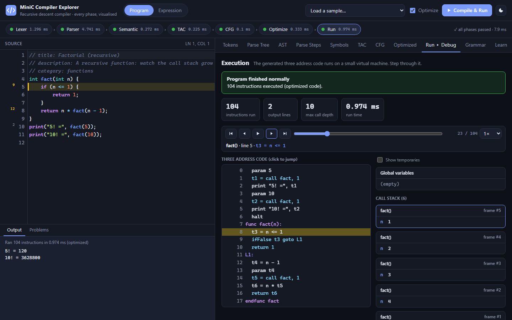

# MiniC Compiler Explorer

An educational compiler for **MiniC**, a small C-like language. It is built around a hand-written
**recursive descent parser**, and every phase of the compiler can be inspected in an interactive web UI:

```
source ─► Lexer ─► Parser ─► Semantic analysis ─► Three Address Code ─► CFG ─► Optimizer ─► VM
          tokens   parse tree,  scopes, types       labels & jumps      basic    folding,     step-through
                   AST, trace                                           blocks   dead code    debugger
```

It also contains the original **Interactive Arithmetic Expression Analyzer** (Expression mode).
That mode uses exactly the grammar `E → T E'`, `E' → + T E' | - T E' | ε`, `T → F T'`,
`T' → * F T' | / F T' | ε`, `F → ( E ) | id | num`.



## Features

| Phase | What you can see |
|---|---|
| Lexical analysis | Token stream and token table (lexeme, type, line:col), counts per category |
| Syntax analysis | Parse tree that can **grow step by step**, AST (graph or outline), the full parser trace (function, lookahead, production, ε-decisions) |
| Error handling | Precise `line:col` errors with *found / expected / hint*; panic-mode and phrase-level **recovery** report several syntax errors at once |
| Semantic analysis | Scope tree, symbol table, type-annotated AST; undeclared/redeclared names, type mismatches, bad conditions, wrong arguments, missing returns |
| Intermediate code | Three address code and quadruples; hover any line to see the source it came from |
| Control flow graph | Basic blocks (leaders algorithm) with loop back-edges highlighted |
| Optimization | Constant folding/propagation, algebraic simplification, dead code and unreachable code removal, with a before/after diff |
| Execution | A virtual machine runs the TAC; a time-travel debugger shows the current line, variables, the **call stack** and output |
| Theory | Grammar panel with computed FIRST/FOLLOW sets and the LL(1) table, plus a "Learn" panel explaining each phase for *your* code |

The MiniC language has:
- types `int`, `float` and `bool`;
- `if/else`, `while`, `do-while`, `for`, `break` and `continue`;
- functions with recursion;
- operators `+ - * / %`, comparisons, `&& || !` (short-circuit), unary minus, and `+= -= *= /= ++ --`;
- block scopes, `print(...)`, and `//` and `/* */` comments.

See [docs/language-spec.md](docs/language-spec.md).

## Quick start

**Windows, one click:** double-click `start.bat`. It sets up the environment on first run, starts the server and
opens the browser. Keep that window open while you use the app; closing it stops the server
(the browser then shows `ERR_CONNECTION_REFUSED`).

**Manual (PowerShell):**

```powershell
python -m venv .venv
.venv\Scripts\Activate.ps1
pip install -r requirements-dev.txt
uvicorn server.app:app --reload
```

Open <http://localhost:8000>. On macOS/Linux, activate with `source .venv/bin/activate`; the other commands are the same.

Everything works offline: CodeMirror and Mermaid are bundled in `web/vendor/`.

### Command line

```powershell
python -m compiler run examples\programs\04_factorial_recursive.mc --tac --cfg
python -m compiler run examples\programs\18_constant_folding.mc --optimize
python -m compiler expr "a + b * (c - 2)" --var a=3 --var b=4 --var c=7 --all
python -m compiler repl
```

Exit codes: `0` ok, `1` compile error, `2` runtime error. `--json` prints the full result.

### Tests

```powershell
python -m pytest                        # unit, golden, differential, fuzz, API, CLI
python -m pytest --cov=compiler         # with coverage
pip install playwright; python -m playwright install chromium
python -m pytest -m e2e                 # browser end-to-end tests
```

The suite has more than 1,150 tests and covers 97% of the compiler package. It includes:
- a test that proves the grammar is LL(1);
- golden tests for all 23 sample programs;
- differential tests that compare optimized and unoptimized code on hundreds of random programs.

## Project structure

```text
compiler/            pure-Python compiler (no third-party dependencies)
  common/            source positions, diagnostics + error codes, limits
  lexer/             tokens and the hand-written scanner
  syntax/            grammar (as data), FIRST/FOLLOW + LL(1) table, recursive descent parser,
                     parse tree, AST, parser trace
  semantic/          scoped symbol table and type checker
  ir/                three address code generator, control flow graph
  opt/               optimizer passes
  runtime/           TAC virtual machine
  render/            text renderings for the CLI
  pipeline.py        runs and times all phases → one JSON result
  cli.py             command-line interface
server/              FastAPI app: /api/compile, /api/examples, /api/grammar, /api/info
web/                 single-page UI (vanilla JS modules, CodeMirror, Mermaid, SVG trees)
examples/            sample programs (*.mc with expected *.out) and expressions
tests/               unit, golden, differential, fuzz, API, CLI and e2e tests
docs/                language spec, grammar, architecture, IR spec, error catalog, decisions,
                     demo script, viva notes
scripts/             helper scripts (error catalog generator)
```

## Documentation

- [Language specification](docs/language-spec.md)
- [Grammar, FIRST/FOLLOW and LL(1) design](docs/grammar.md)
- [Architecture and data flow](docs/architecture.md)
- [Intermediate representation](docs/ir-spec.md)
- [Error catalog](docs/error-catalog.md)
- [Design decisions](docs/decisions.md)
- [Demo script](docs/demo-script.md)
- [Viva notes](docs/viva-notes.md)

## Limitations

- MiniC is a teaching language: it has no strings as values, arrays, pointers or structs, and functions are top-level only.
- Integers have arbitrary precision. They do not wrap at 32 bits as in C.
- Code generation targets a virtual machine, not native machine code.
- Execution is capped at 100,000 instructions, 200 nested calls, 1,000 output lines and 2 seconds.
- Input is capped at 10,000 characters and 400 lines.
